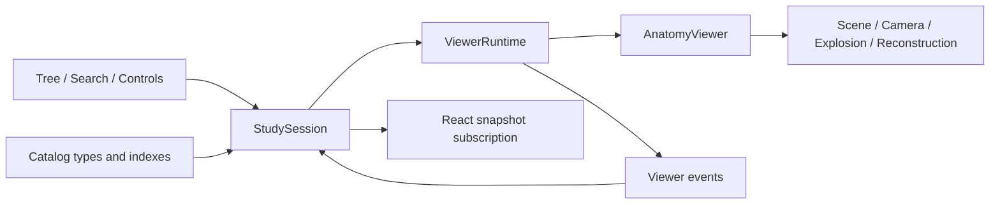

# Architecture and module ownership

Human Atlas keeps the React interface, study rules, browser viewer and portable
Rust logic in separate modules. New screens reuse the study and viewer modules;
they do not copy the model screen's loading or interaction code.

## Where to make a change

| Concern | Owner | Interface |
| --- | --- | --- |
| Catalog and structure types | `apps/web/src/anatomy/catalog/types.ts` | `Catalog`, `StudyTarget`, `Model`, `Structure` |
| Membership and hierarchy lookup | `apps/web/src/anatomy/catalog/index.ts` | `structureIds`, `indexCatalog` |
| Catalog validation and embedded data | `crates/anatomy_core` | `Catalog::from_json`, `catalog_json` |
| Study interactions and UI snapshots | `apps/web/src/anatomy/study/session.ts` | `StudySession` |
| Canvas lifecycle and renderer commands | `apps/web/src/anatomy/viewer/runtime.ts` | `ViewerRuntime` |
| Download, metadata validation and preparation worker | `apps/web/src/anatomy/viewer/loader.ts` | `loadModels`, `validateMetadata` |
| Pointer input and wheel coordinates | `apps/web/src/anatomy/viewer/input.ts` | `bindViewerInput` (internal to the runtime) |
| App context menu and text clipboard | `apps/web/src/context-menu.tsx`, `clipboard.ts` | `ContextMenu`, `textContext` |
| Study screen geometry | `apps/web/src/anatomy/viewer/layout.ts` | `measureViewport` |
| Screen composition and focus restoration | `apps/web/src/anatomy/model-viewer.tsx` | `ModelViewer` |
| Reference reading | `apps/web/src/anatomy/wikipedia-reader.tsx` | `WikipediaReader` |
| Browser bindings, GPU resources and draw passes | `crates/anatomy_wasm` | `AnatomyViewer` |
| Geometry, camera, scene, explosion and visibility animation | `crates/anatomy_renderer` | Portable Rust types |
| Model regeneration | `apps/web/scripts/import-models.mjs` and Python exporters | Validated GLB/JSON packages and catalog |

`core.ts` bootstraps WASM and chooses the browser or Tauri catalog endpoint.
It does not own domain types or study state. The Tauri shell reuses the web
interface and supplies the native `get_catalog` command.

## Page modules

Each page owns its directory and URL: Home at /home, Anatomy at /anatomy,
Lessons at /lessons, and Games at /games. The root URL also opens Home.
Home provides a short overview with links to the other three pages.
Games and Lessons currently provide empty page components.

The shared pages/module-layout.tsx owns the header, viewport height, outer frame
and the single .model-space with a shared theme background. Pages fill that space;
they do not add another frame or calculate their own viewport height.
Anatomy styles live in anatomy/style.css. On compact screens, its catalog and
information panels open individually over the viewer. Only panel content scrolls.
The desktop host starts at /home. Internal module links then switch React pages
inside the shared layout without changing the URL or reloading the WebView.
The web app keeps normal URL navigation. Leaving a module unmounts its content;
returning to Anatomy creates a new viewer and study session.
On macOS, the native window controls overlay the shared header. The header reserves
space for them and its noninteractive area drags the window; browser layouts keep
their normal header spacing.

## State and command flow



`StudySession` owns logical visibility, the current folder, focused structures,
the article being read, reader expansion and the explosion control value.
React subscribes with `useSyncExternalStore`. Treat snapshots and their collections
as read-only. Expanded tree branches and the search query remain local UI state.
The session also owns Back/Forward history for selected and focused anatomy
destinations. Hover, visibility controls and manual camera movement do not add
history entries. Returning to a focused destination reapplies its focus command;
navigation does not store individual pan, rotation or zoom positions.

The runtime owns its canvas, WASM instance, worker lifecycle, animation scheduling,
input bindings and observers. Rust owns rendered geometry, camera coordinates and
animation progress. Scene visibility is the renderer's projection of study commands;
UI code must not mutate it separately.

Manual separation uses `Separation` in the renderer, keyed by stable structure IDs,
so all material primitives move together without changing source geometry.
The runtime publishes the active moving ID and separated IDs to the session and
owns pointer drag transactions. Capture loss cancels the current drag; T restores
the dragged or selected structure. Detached structures remain draggable while
other structures cannot move. Manual separation and automatic
explosion are mutually exclusive. Picking, outlines, shadows and displayed bounds
use the same composed offsets.
Model context actions require an existing selection and never select on right-click.
While moving a structure, left drags on other anatomy do not rotate the scene;
background drags retain camera navigation. Reference reading is limited to the
structure in movement mode or structures with committed separation offsets.

The context menu handles the whole application and keeps clipboard access behind
explicit Copy/Paste actions. It captures text selections before moving focus and
restores them before editing. Shift plus a secondary click leaves the native menu
available. The sandboxed Wikipedia frame forwards only menu coordinates and selected
text; the parent validates the frame window and payload before showing its menu.

`ModelViewer` owns device graphics preferences, independently of study history.
`ViewerRuntime.setGraphics` applies model display resolution and frame limits;
`AnatomyViewer.set_graphics` configures independent shadow and lighting quality
and the background grid. The runtime counts actual viewer frames and publishes
FPS through `onFps`, separately from study snapshots. Its sampling timer runs only
while the counter is enabled and is cleared on failure or disposal.
Changing graphics quality reallocates render targets without reframing the camera
or changing anatomy visibility.

The `StudyViewer` interface in `viewer/contracts.ts` connects the session to the
runtime. Geometry-changing session commands commit visibility and focus state only
after the runtime reports success. Runtime failures publish an error and stop
rendering; they are not silently converted into successful UI changes.

Browsing information, selecting geometry, focusing geometry and hovering are
separate actions. A hover never replaces the article being read. The session
decides whether folder focus needs a reveal from logical visibility, independently
of the row's selected style. The runtime applies the visibility/focus sequence,
including fade-out for structures outside the focused folder.

## Reusing a viewer

Create one `StudySession` for the catalog and one `ViewerRuntime` per canvas host.
Pass a normalized viewport and a pointer interaction rectangle to the runtime;
it does not look up study-screen CSS selectors. `ModelViewer` demonstrates the
composition. Another layout can supply different rectangles without replacing the
loader, session rules or rendering loop.

Connect the runtime with `session.connect(runtime)`, route `onState` to
`session.updateViewer` and `onPick` to `session.pick`, then call `runtime.start(roots)`.
Subscribe to the session snapshot for UI updates. Route checkbox changes to
`changeVisibility`, information selection to `browseStructure`/`browseTarget`,
focus requests to `focus`, and camera controls to `control`.

On unmount, disconnect that runtime and call `dispose()`. Disposal cancels fetch
and worker preparation, removes event listeners and observers, cancels animation
frames, frees WASM/WebGL resources and removes the canvas. Create a new runtime
for a new mount; do not restart a disposed instance.

## Rules to preserve

- Keep stable source IDs, metadata validation, model membership and source hierarchy.
- A root system uses `model.structure_ids`; anatomical subfolders use `structure_ids`.
- Loading/reconstruction follows catalog source order. Tree display order is separate.
- Prepare and frame all systems before the first reconstruction frame.
- Wheel zoom uses canvas-relative cursor coordinates; E/Q zoom uses screen center.
- Keep reduced motion, interrupted transitions, rapid toggles and cleanup working.
- Keep renderer mechanics in Rust and browser/DOM integration in TypeScript.
- Add a module interface when it owns behavior that callers should not reproduce.
  A new folder alone does not establish ownership.

## Verification

Run `npm run check`, `npm test` and `npm run build` from the repository root.
`study-session.test.mjs` covers session rules and failed command handling;
`viewer-runtime.browser.mjs` exercises independent hosts, disposal and cancelled
initialization/preparation with the real WASM renderer.

Browser probes run against Vite after `.model-canvas[aria-busy="false"]`:

```js
(await import('/tests/viewer-runtime.browser.mjs')).checkViewerRuntime()
(await import('/tests/focus.browser.mjs')).checkFocusTree()
(await import('/tests/controls.browser.mjs')).checkControls()
(await import('/tests/context-menu.browser.mjs')).checkContextMenu()
```

Focus checks assume a fresh page with every system initially visible. Camera,
explosion, search, reader and startup probes live beside these tests. Keep their
behavior checks when moving ownership; static markup assertions alone do not
establish interaction equivalence.

On Home, `checkModuleNavigation()` from `tests/module-layout.browser.mjs` checks
desktop navigation with mocked Tauri catalog IPC and verifies that web links keep
their default behavior. This does not replace a native WebView smoke test.
