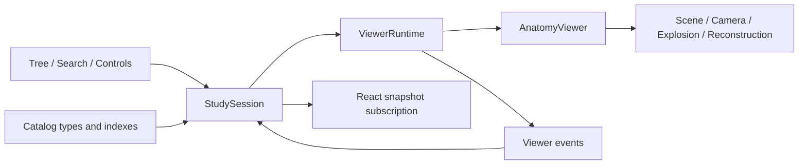

# Architecture and module ownership

Human Atlas keeps the React interface, study rules, browser viewer and portable
Rust logic in separate modules. New screens reuse the study and viewer modules;
they do not copy the model screen's loading or interaction code.

## Where to make a change

| Concern | Owner | Interface |
| --- | --- | --- |
| Catalog and structure types | `apps/web/src/anatomy/catalog/types.ts` | `Catalog`, `StudyTarget`, `Model`, `Structure` |
| Membership and hierarchy lookup | `apps/web/src/anatomy/catalog/index.ts` | `structureIds`, `indexCatalog` |
| Catalog validation and embedded data | `crates/anatomy_core` | `Catalog::from_json`, `catalog_json` |
| Study interactions and UI snapshots | `apps/web/src/anatomy/study/session.ts` | `StudySession` |
| Canvas lifecycle and renderer commands | `apps/web/src/anatomy/viewer/runtime.ts` | `ViewerRuntime` |
| Download, metadata validation and preparation worker | `apps/web/src/anatomy/viewer/loader.ts` | `loadModels`, `validateMetadata` |
| Pointer input and wheel coordinates | `apps/web/src/anatomy/viewer/input.ts` | `bindViewerInput` (internal to the runtime) |
| Opt-in camera lifecycle and landmark inference | `apps/web/src/anatomy/viewer/hand-camera.ts`, `hand-worker.ts` | `startHandCamera` |
| Hand gesture state and camera deltas | `crates/anatomy_renderer/src/hand_input.rs` | `HandInput`, exposed by WASM `HandGestureController` |
| Study screen geometry | `apps/web/src/anatomy/viewer/layout.ts` | `measureViewport` |
| Screen composition and focus restoration | `apps/web/src/anatomy/model-viewer.tsx` | `ModelViewer` |
| Reference reading | `apps/web/src/anatomy/wikipedia-reader.tsx` | `WikipediaReader` |
| Browser bindings, GPU resources and draw passes | `crates/anatomy_wasm` | `AnatomyViewer` |
| Geometry, camera, scene, explosion and visibility animation | `crates/anatomy_renderer` | Portable Rust types |
| Model regeneration | `apps/web/scripts/import-models.mjs` and Python exporters | Validated GLB/JSON packages and catalog |

Within `crates/anatomy_wasm/src/renderer`, `api.rs` owns constructors and prepared
package ingestion. `camera.rs`, `graphics.rs`, `scene.rs` and `separation.rs` group
the corresponding WASM methods; `explosion.rs` retains explosion behavior.
Hand gesture tests live in `crates/anatomy_renderer/tests/hand_input.rs`.

`core.ts` bootstraps WASM and chooses the browser or Tauri catalog endpoint.
It does not own domain types or study state. The Tauri shell reuses the web
interface and supplies the native `get_catalog` command.

## Backend ownership

`apps/backend/` is the single FastAPI application root. Follow its
[backend setup and folder contract](README.md#backend-development) when implementing APIs,
authentication, lesson persistence, Games results or dashboard queries.
The app entry point is `app/main.py`; `app/api/router.py` composes domain routers
under `/api/v1`. Business code lives in `app/modules/<domain>/`, database setup
in `app/database.py`, migrations in `migrations/` and backend tests in `tests/`.

SQLite at `apps/backend/data/development.sqlite3` is for development/tests.
Tests supply temporary database paths; importing the application does not create
or modify a database. Python dependencies are declared in the repository root
requirements files.
The initial scaffold provides only a database health check and domain packages;
authentication, lesson contracts and frontend integration remain unimplemented.

Lessons reference existing catalog structure IDs and reuse the frontend viewer.
Backend content and progress persistence do not take over StudySession,
ViewerRuntime or Rust rendering. Authoring interfaces share one lesson format;
the backend owner must agree that format with the frontend before implementing it.

## Page modules

Each page owns its directory and URL: Home at /home, Anatomy at /anatomy,
Lessons at /lessons, and Games at /games. The root URL also opens Home.
Home links to all three modules. Lessons and Games are temporarily locked in the
interface; their direct routes remain available.

The shared pages/module-layout.tsx owns the header, viewport height, outer frame
and the single .model-space with a shared theme background. Pages fill that space;
they do not add another frame or calculate their own viewport height.
Anatomy styles live in anatomy/style.css. On compact screens, its catalog and
information panels open individually over the viewer. Only panel content scrolls.
The desktop host starts at /home. Internal module links then switch React pages
inside the shared layout without changing the URL or reloading the WebView.
The web app keeps normal URL navigation. Leaving a module unmounts its content;
returning to Anatomy creates a new viewer and study session.
On macOS, the native window controls overlay the shared header. The header reserves
space for them and its noninteractive area drags the window; browser layouts keep
their normal header spacing.

## State and command flow



`StudySession` owns logical visibility, the current folder, focused structures,
the article being read, reader expansion and the explosion control value.
React subscribes with `useSyncExternalStore`. Treat snapshots and their collections
as read-only. `canReadStructure` shares the reference-reading rule with the UI.
Viewer snapshots carry status codes; the UI translates them into messages.
Expanded tree branches and the search query remain local UI state.
Large folders initially mount 40 direct structure rows. Scrolling or keyboard
focus near the end loads more rows. Search/history reveal loads through its
target before scrolling it into view; closing a folder resets its initial limit.
The session also owns Back/Forward history for selected and focused anatomy
destinations. Hover, visibility controls and manual camera movement do not add
history entries. Returning to a focused destination reapplies its focus command;
navigation does not store individual pan, rotation or zoom positions.

The runtime owns its canvas, WASM instance, worker lifecycle, animation scheduling,
input bindings and observers. Rust owns rendered geometry, camera coordinates and
animation progress. Scene visibility is the renderer's projection of study commands;
UI code must not mutate it separately.

Experimental hand controls use a separate opt-in worker for MediaPipe inference
and a persistent Rust/WASM `HandGestureController`. Each hand crosses the boundary
as 65 floats: handedness (0 left, 1 right), handedness score, then 21 normalized
landmarks in x/y/z order. Timestamp and camera aspect ratio accompany each frame.
Rust validates this input, mirrors the horizontal coordinates to match the preview,
owns filtering and pinch state, and returns camera commands. TypeScript forwards
commands through `StudySession.control`; inference never mutates the viewer.
Left-hand capture emits camera pan, right-hand capture emits rotation, and two-hand
capture emits only zoom from hand separation. Handedness comes from MediaPipe's
classification, independent of detection order or the hand's screen position.
`measureHandRegion` maps the focus frame and visible UI obstacles into mirrored
camera-image coordinates, accounting for letterboxing even with the video hidden.
The worker sends that region to Rust with each frame. Rust admits fresh pinches
inside its first rectangle and outside the remaining obstacle rectangles, captures
the participating hands, and keeps capture outside the start area. A fresh second
pinch may join with a new baseline; release or loss of any captured hand ends the
session. Reset, tracking gaps and jumps require release before a new capture.
Per-hand states (`outside`, `ready`, `release`, `active`) drive the interaction
dot and pressed-button feedback; physical pinch alone does not imply
active control.
Rust also returns mirrored, smoothed cursor positions and all 21 hand landmarks,
per-hand pinch state and zoom direction. `HandInteractionOverlay` projects the
hands and their rotate, pan, or zoom state over the model. The overlay follows
the letterboxed camera image and does not interact with scene geometry.
The camera adapter clears visual feedback after 250 ms without fresh tracking.
Only one camera frame is in flight. Manual input, unrelated popovers and unavailable
anatomy suspend actions and reset their baseline, while inference keeps hands
visible and current. `set_suspended` suppresses camera actions in Rust without
discarding validated landmarks. Hidden or unfocused pages pause inference and
clear visual feedback. Stopping or unmounting releases camera tracks, pending
frames and the worker.

`ModelViewer` owns the camera mode shared by the menu-bar switch and
`HandCameraControls`. The camera switch sits beside history navigation. Camera
mode keeps the catalog and information panels available; `measureViewport`
continues to fit the hand control area between the visible panels on desktop and
below the compact panel toggles on smaller screens. Camera errors switch the mode
off.
`useCameraDevices` owns device enumeration and the selection shared by Settings
and `HandCameraControls` through `ModelViewer`. It refreshes after camera access,
device changes and window focus. Selecting a device restarts `startHandCamera`
with an exact `deviceId`, releasing the previous stream and worker first.
When device IDs or labels are hidden, Settings can request video-only permission
through this hook. Its temporary stream is released after enumeration or unmount;
the permission action does not enable hand tracking.
`HandCameraControls` owns the camera lifecycle and hand overlay. Hands only
control the model: a left-hand pinch pans, a right-hand pinch rotates, and
pinching with both hands zooms by changing their separation. The smoothed hand
cursor and active state remain visible while these
gestures run. Hand controls do not activate panels or application actions.
`measureHandImage` supplies the letterboxed image rectangle used for feedback and
for mapping the allowed model region. `cancel_controls` resets gesture capture
while preserving the landmark filter; full tracking resets remain available for
invalid or stale input. Camera movement remains blocked during separation.

Manual separation uses `Separation` in the renderer, keyed by stable structure IDs,
so all material primitives move together without changing source geometry.
The runtime publishes the active moving ID and separated IDs to the session and
owns pointer drag transactions. A one-second left hold on a structure starts manual
separation and dragging in the same gesture; the UI shows cursor progress through
`onHold`. Movement before the hold completes keeps camera navigation.
Capture loss cancels the current drag; T restores manual positions.
`Separation` owns restoration offsets, the 420 ms easing and pending group targets.
The runtime submits one restoration command, advances it once per frame through
WASM, and publishes completion to the session. TypeScript retains only target IDs
for UI synchronization. Reduced motion finishes the Rust transition immediately;
direct position changes and overview cancel pending restoration.
Detached structures remain draggable while
other structures cannot move. Manual separation and automatic
explosion are mutually exclusive. Picking, outlines, shadows and displayed bounds
use the same composed offsets.
`Separation` owns connected groups and snap candidates. Candidates require nearby
source primitive bounds, visible active pieces and matching 3D offsets, with a
camera-scaled tolerance capped by structure and body size. These are geometric
suggestions, not validated anatomical connectors. The runtime publishes a transient
hint through `onSnap`; WASM outlines its target without changing the selection.
Release revalidates the preview before joining. Group drags and rollback apply the
same offset to every member; holding a member detaches it without moving its peers.
Joining the body clears the group's manual offsets and restores normal navigation.
While moving a structure, left drags on other anatomy do not rotate the scene;
background drags retain camera navigation. Reference reading is limited to the
structure in movement mode or structures with committed separation offsets.

The 3D canvas reserves right-button input for camera pans and blocks context menus.
Elsewhere, context menus and text clipboard operations use the browser or WebView's
native behavior, including inside the sandboxed Wikipedia frame.

`ModelViewer` owns device graphics preferences, independently of study history.
`ViewerRuntime.setGraphics` applies model display resolution and frame limits;
`AnatomyViewer.set_graphics` configures independent shadow and lighting quality
and the background grid. The runtime counts actual viewer frames and publishes
FPS through `onFps`, separately from study snapshots. Its sampling timer runs only
while the counter is enabled and is cleared on failure or disposal.
Changing graphics quality reallocates render targets without reframing the camera
or changing anatomy visibility.

The `StudyViewer` interface in `viewer/contracts.ts` connects the session to the
runtime. Geometry-changing session commands commit visibility and focus state only
after the runtime reports success. Runtime failures publish an error and stop
rendering; they are not silently converted into successful UI changes.

Browsing information, selecting geometry, focusing geometry and hovering are
separate actions. A hover never replaces the article being read. The session
decides whether folder focus needs a reveal from logical visibility, independently
of the row's selected style. The runtime applies the visibility/focus sequence,
including fade-out for structures outside the focused folder.

## Reusing a viewer

Create one `StudySession` for the catalog and one `ViewerRuntime` per canvas host.
Pass a normalized viewport and a pointer interaction rectangle to the runtime;
it does not look up study-screen CSS selectors. `ModelViewer` demonstrates the
composition. Another layout can supply different rectangles without replacing the
loader, session rules or rendering loop.

Connect the runtime with `session.connect(runtime)`, route `onState` to
`session.updateViewer` and `onPick` to `session.pick`, then call `runtime.start(roots)`.
Subscribe to the session snapshot for UI updates. Route checkbox changes to
`changeVisibility`, information selection to `browseStructure`/`browseTarget`,
focus requests to `focus`, and camera controls to `control`.

On unmount, disconnect that runtime and call `dispose()`. Disposal cancels fetch
and worker preparation, removes event listeners and observers, cancels animation
frames, frees WASM/WebGL resources and removes the canvas. Create a new runtime
for a new mount; do not restart a disposed instance.

## Rules to preserve

- Keep stable source IDs, metadata validation, model membership and source hierarchy.
- A root system uses `model.structure_ids`; anatomical subfolders use `structure_ids`.
- Loading/reconstruction follows catalog source order. Tree display order is separate.
- Prepare and frame all systems before the first reconstruction frame.
- Wheel zoom uses canvas-relative cursor coordinates; E/Q zoom uses screen center.
- Keep reduced motion, interrupted transitions, rapid toggles and cleanup working.
- Keep renderer mechanics in Rust and browser/DOM integration in TypeScript.
- Add a module interface when it owns behavior that callers should not reproduce.
  A new folder alone does not establish ownership.

## Verification

Run `npm run check`, `npm test` and `npm run build` from the repository root.
`npm run test:browser` runs the focused Chromium suite with the existing
Playwright/browser paths documented in README, using isolated profiles and
synthetic camera input. It includes startup and preference changes with blocked
browser storage.
`study-session.test.mjs` covers session rules and failed command handling;
`viewer-runtime.browser.mjs` exercises independent hosts, disposal and cancelled
initialization/preparation with the real WASM renderer.

Browser probes run against Vite after `.model-canvas[aria-busy="false"]`:

```js
(await import('/tests/viewer-runtime.browser.mjs')).checkViewerRuntime()
(await import('/tests/focus.browser.mjs')).checkFocusTree()
(await import('/tests/controls.browser.mjs')).checkControls()
(await import('/tests/context-menu.browser.mjs')).checkNativeContextMenu()
(await import('/tests/assembly.browser.mjs')).checkAssembly()
```

Focus checks assume a fresh page with every system initially visible. Camera,
explosion, search, reader and startup probes live beside these tests. Keep their
behavior checks when moving ownership; static markup assertions alone do not
establish interaction equivalence.

On Home, `checkModuleNavigation()` from `tests/module-layout.browser.mjs` checks
desktop navigation with mocked Tauri catalog IPC and verifies that web links keep
their default behavior. This does not replace a native WebView smoke test.
